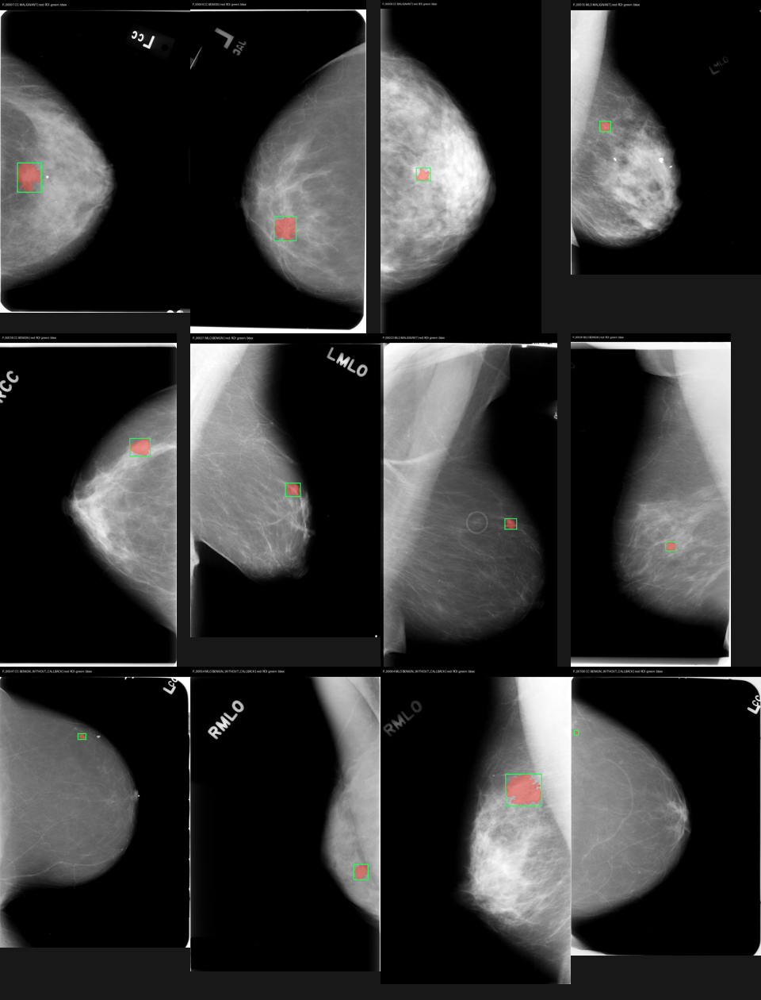

# TASK-02 — CBIS-DDSM mass data smoke test

**Date:** 2026-11-05  
**Decision:** **CONDITIONAL GO** for further research feasibility work; no model training, clinical use, or full-dataset acquisition is authorized by this result.

## Scope and reproducibility

Only [TCIA's official CBIS-DDSM collection](https://www.cancerimagingarchive.net/collection/cbis-ddsm/) was used. The two official mass CSVs were downloaded from TCIA's [training CSV](https://wiki.cancerimagingarchive.net/download/attachments/22516629/mass_case_description_train_set.csv?version=1&modificationDate=1506796355038&api=v2) and [test CSV](https://wiki.cancerimagingarchive.net/download/attachments/22516629/mass_case_description_test_set.csv?version=1&modificationDate=1506796343175&api=v2) attachments. Images came from TCIA's documented public NBIA [`getImageWithMD5Hash` API](https://wiki.cancerimagingarchive.net/display/Public/NBIA+Search+REST+API+Guide), by **24 individually selected series UIDs** only: one full-mammogram series and one two-object ROI/crop series per selected row. No full-collection or mass-subset manifest was downloaded.

Original CSVs and the 24 returned ZIPs are kept under [`data/cbis_ddsm/original`](../data/cbis_ddsm/original). They were read without editing. Reproducible derived records are [`task02_selection.json`](../data/cbis_ddsm/task02_selection.json), [`task02_series_sizes.json`](../data/cbis_ddsm/task02_series_sizes.json), and [`task02_validation.json`](../data/cbis_ddsm/task02_validation.json). The scripts are [`task02_csv_audit.py`](../scripts/task02_csv_audit.py), [`task02_fetch_series.py`](../scripts/task02_fetch_series.py), and [`task02_validate.py`](../scripts/task02_validate.py).

**Data attribution:** Sawyer-Lee, R., Gimenez, F., Hoogi, A., & Rubin, D. (2016). *Curated Breast Imaging Subset of Digital Database for Screening Mammography (CBIS-DDSM)* [Data set]. The Cancer Imaging Archive. [https://doi.org/10.7937/K9/TCIA.2016.7O02S9CY](https://doi.org/10.7937/K9/TCIA.2016.7O02S9CY). Licensed [CC BY 3.0](https://creativecommons.org/licenses/by/3.0/). The overlays and contact sheet are resized, contrast-adjusted derivatives with colored mask and box marks; they are not original TCIA images.

| Original CSV | Bytes | SHA-256 |
| --- | ---: | --- |
| `mass_case_description_train_set.csv` | 772,727 | `a4bcc1c32bfd040212737e6e8c304819334abe717cfefff56431dc50ae6db723` |
| `mass_case_description_test_set.csv` | 217,038 | `60f0b4504ec024106bbdd1555030d220163ea9da0ea4688473a4c9c3e8ab0457` |

## VERIFIED — CSV audit

| Measure | Training | Test |
| --- | ---: | ---: |
| CSV rows (lesion/view records, **not** participants) | 1,318 | 378 |
| Distinct `patient_id` values (`P_#####`) | 691 | 201 |
| `MALIGNANT` rows | 637 | 147 |
| `BENIGN` rows | 577 | 194 |
| `BENIGN_WITHOUT_CALLBACK` rows | 104 | 37 |
| CC / MLO rows | 607 / 711 | 177 / 201 |
| Unique full-image paths | 1,231 | 361 |
| Full-image paths with more than one pathology value | 6 | 2 |
| Participants with more than one pathology value | 13 | 5 |
| Blank full/crop/mask path fields | 0 | 0 |
| `ROI mask file path` values with outer whitespace | **1,318** | **378** |

The training and test sets have **zero overlap by the CSV `patient_id` key**. This checks the mass CSVs only; it does not establish independence from other TCIA subsets or rule out other forms of correlation. Every ROI mask path ends with trailing whitespace/newline in the original CSV; working copies of field values were `.strip()`-normalized before indexing, while the source files stayed intact. Six training and two test full-image paths carry conflicting pathology among their rows, so full-image classification requires an explicit multi-lesion labeling policy. TCIA itself cautions that its DICOM Patient IDs can multiply per underlying participant; the CSV `P_#####` key was used for this audit. [TCIA collection note](https://www.cancerimagingarchive.net/collection/cbis-ddsm/).

## VERIFIED — selection and acquisition

The deterministic selection took one training row from each of **12 distinct `P_#####` participants**: four `MALIGNANT`, four `BENIGN`, and four `BENIGN_WITHOUT_CALLBACK`, with two CC and two MLO rows in each source label. It selected the first eligible participant/lesion in sorted order within each label/view group. This intentionally probes the third source label and does not represent prevalence or random sampling.

TCIA's `getSeriesSize` metadata for these 24 series reported **36 DICOM objects** (12 full mammograms, 12 ROI masks, 12 crops) and **608,336,956 uncompressed bytes** (580.2 MiB). All 24 ZIPs were ultimately downloaded, totaling **173,161,662 bytes** (165.1 MiB), plus 989,765 bytes of original CSVs. The initial transfer pass had incomplete responses for several full-image ZIPs; a lower-concurrency retry recovered them, and P_00106 required a third ZIP attempt. A slower direct single-image fallback was stopped and its incomplete fragment removed. **Final acquisition success: 24/24 series, 12/12 cases.** These are observed transfer outcomes, not an availability guarantee.

| Case | Source pathology | View | Full + ROI ZIP (MiB) | Mask bbox, full-image pixels, inclusive `(x0,y0,x1,y1)` |
| --- | --- | --- | ---: | --- |
| P_00001 | MALIGNANT | CC | 10.22 | (270, 2422, 660, 2896) |
| P_00009 | MALIGNANT | CC | 7.47 | (485, 2176, 684, 2356) |
| P_00015 | MALIGNANT | MLO | 15.93 | (601, 2322, 844, 2556) |
| P_00023 | MALIGNANT | MLO | 24.47 | (2304, 3251, 2530, 3456) |
| P_00004 | BENIGN | CC | 11.93 | (1417, 3500, 1799, 3925) |
| P_00018 | BENIGN | CC | 8.02 | (1894, 1388, 2197, 1653) |
| P_00021 | BENIGN | MLO | 11.18 | (1449, 2123, 1685, 2337) |
| P_00026 | BENIGN | MLO | 21.56 | (1986, 4175, 2220, 4376) |
| P_00041 | BENIGN_WITHOUT_CALLBACK | CC | 17.61 | (1623, 1175, 1801, 1309) |
| P_00106 | BENIGN_WITHOUT_CALLBACK | CC | 16.67 | (65, 1091, 160, 1198) |
| P_00054 | BENIGN_WITHOUT_CALLBACK | MLO | 8.16 | (2504, 2869, 2732, 3114) |
| P_00064 | BENIGN_WITHOUT_CALLBACK | MLO | 11.91 | (1857, 1439, 2398, 1918) |

## VERIFIED — DICOM, mapping, and mask validation

- **36/36 DICOM objects** decoded with `pydicom 3.0.2` and NumPy 2.5.4. All had transfer syntax `1.2.840.10008.1.2` (Implicit VR Little Endian). In the sampled full mammograms, heights ranged from **4,441–6,796** pixels and widths from **2,206–4,000** pixels. `Pillow 13.0.0` rendered derived overlays. No GPU or model was used.
- **36/36** DICOM MD5 values matched the `md5hashes.csv` supplied inside TCIA's ZIPs. **36/36** DICOM Series Instance UIDs matched the requested UIDs. DICOM `PatientID` values matched the selected CSV path's participant, side, and view components.
- **12/12** ROI series had exactly two DICOM objects. In every sampled case, one was a nonempty, two-value mask with the **same pixel dimensions as the full mammogram** and DICOM Series Description `ROI mask images`; the other was a smaller crop with description `cropped images`. The binary foreground occupied 0.026%–1.358% of full-image pixels. **12/12** masks yielded an in-bounds bounding box. A same-size, binary mask and plausible overlay are technical checks; they do not certify anatomical contour correctness.
- The selected CSV crop and mask paths pointed to the same ROI/crop series but to `000000.dcm` and `000001.dcm` respectively (after whitespace trimming). TCIA's API ZIPs instead named the two objects `00000001.dcm` and `00000002.dcm`; in the inspected ZIPs, `00000001.dcm` was the **mask** and `00000002.dcm` was the **crop**. Direct filename joining would fail and suffix-order assumptions would misassign them. We identified objects by series UID, DICOM description, dimensions, and binary content. The [NBIA API documentation](https://wiki.cancerimagingarchive.net/display/Public/NBIA+Search+REST+API+Guide) explicitly warns that `NewFileNames` changes naming; the [TFDS CBIS-DDSM builder](https://github.com/tensorflow/datasets/blob/master/tensorflow_datasets/image_classification/cbis_ddsm.py#L3128-L3175) separately documents crop/mask ambiguity.

## Visual overlays

Red shows mask foreground; green is the extracted inclusive bounding box. These are resized presentation copies generated from the original ZIP contents. The originals were not modified. The contact sheet covers all 12 cases; three larger examples span source labels and views.

- [Malignant, CC: P_00001](figures/task02_P_00001_CC_overlay.png)
- [Benign, CC: P_00004](figures/task02_P_00004_CC_overlay.png)
- [Benign without callback, MLO: P_00054](figures/task02_P_00054_MLO_overlay.png)
- [All individual overlays](figures/)

Visual review of the contact sheet found each foreground mask on breast tissue and no obvious gross coordinate inversion. P_00106's selected mask is small and posterior near the image edge; its CSV descriptor is `LYMPH_NODE`, and it warrants specialist review before being treated as a segmentation-quality example. The sample includes no independent radiologist assessment.

## Resources and remaining risks

**Measured:** The 12-case original ZIP set uses 165.1 MiB, while its DICOM contents total 580.2 MiB. Derived PNG overlays total about 3.1 MB. The final 12-case validation pass took about **13.8 seconds** on this workstation (data already downloaded and cached); this is a smoke-test timing, not a throughput benchmark. The largest sampled full image is 6,796 × 3,361 pixels. The D: drive had **77.6 GB free before acquisition** and about **77.4 GB after**, less than TCIA's **163.51 GB whole-collection** listing. Any later full-collection plan needs different storage and space for working copies. [TCIA collection size](https://www.cancerimagingarchive.net/collection/cbis-ddsm/).

**INFERRED:** Processing many full-resolution images concurrently will need substantially more memory than the compressed ZIP size suggests; batch size and GPU memory remain to be benchmarked. A case-level `BENIGN_WITHOUT_CALLBACK` mapping to a binary benign class would require an explicit documented policy. A mass-only, lesion-centered sample cannot establish detection false-positive performance on normal examinations or clinical generalization to current digital mammography.

**UNVERIFIED / blocking for broader claims:** The mask-validity rate across the full mass collection, independent expert contour quality, all-row path resolution, the impact of duplicate/mixed-pathology full images on task labels, normal-exam availability for detection, and model compute requirements. The 12 selected participants were chosen deterministically by low ID, so 12/12 technical success must not be extrapolated as a dataset-wide success rate. No medical-grade feasibility is claimed.

## Recommendation and next task

**CONDITIONAL GO.** The official data can be acquired in small slices and, for this bounded sample, decoded and linked to research masks, crops, and boxes. Before committing to classification, detection, segmentation, XAI, and deployment as a 6–7 month project, define one primary task and run a larger **read-only annotation and split integrity audit** with a predeclared sampling method, explicit handling of mixed-label images, and normal-image coverage for detection. Obtain human approval before any TASK-03 work. No models were trained in TASK-02.

### Evidence links

- [Official TCIA CBIS-DDSM collection, version, access, and data citation](https://www.cancerimagingarchive.net/collection/cbis-ddsm/)
- [Official TCIA NBIA Search REST API guide, `getSeriesSize` and `getImageWithMD5Hash`](https://wiki.cancerimagingarchive.net/display/Public/NBIA+Search+REST+API+Guide)
- [TCIA data usage policy](https://wiki.cancerimagingarchive.net/display/Public/Data+Usage+Policies+and+Restrictions)
- [TFDS builder's documented CBIS-DDSM mask/crop path checks](https://github.com/tensorflow/datasets/blob/master/tensorflow_datasets/image_classification/cbis_ddsm.py#L3084-L3175)
